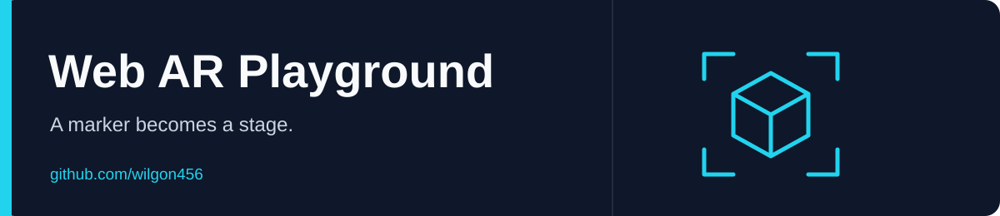

<div align="center">



# Web AR Playground

A marker-based augmented-reality experiment with a bundled animated 3D asset.

**English** · [한국어](README.ko.md)

 

[Repository](https://github.com/wilgon456/WebAR_test)

</div>

---

## Overview

The page combines A-Frame, AR.js and gesture handlers to place `assets/asset.glb` over a custom pattern marker. It uses a webcam source and a looping animation mixer.

## Run locally

```bash
git clone https://github.com/wilgon456/WebAR_test.git
cd WebAR_test
python3 -m http.server 8000
```

Open **http://localhost:8000** and allow camera access. For access from a phone or another machine, host the page over **HTTPS**; a plain LAN HTTP address may not receive camera permission.

Point the camera at the image matching `assets/marker.patt`. That file is an AR pattern definition, not a printable image; the original marker artwork is not included separately.

## Files

| File | Purpose |
| --- | --- |
| `index.html` | AR scene, marker configuration and gesture wiring |
| `assets/asset.glb` | Animated 3D asset |
| `assets/marker.patt` | Custom marker pattern |

## Experiment notes

The app loads libraries from external CDNs, including moving upstream branches. Their availability and browser compatibility can affect the demo. Recognition also depends on the matching marker, lighting and camera support. This repository is a small experiment, not a tested cross-device AR product.
